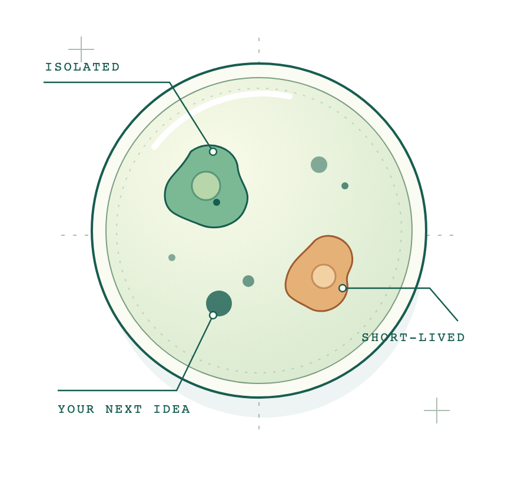

<section class="lab-hero" markdown="1">

# A little space. _For big experiments._

Give your next idea its own little world. Petri creates isolated, short-lived
environments on Kubernetes, so you can try things out and clean up when you're done.

[Get Started](quickstart.md){ .lab-button }
[Learn More](learn.md){ .lab-button .lab-button-secondary }

Open source. Kubernetes native. Made for trying things.

<figure class="lab-figure">
  
</figure>
</section>
